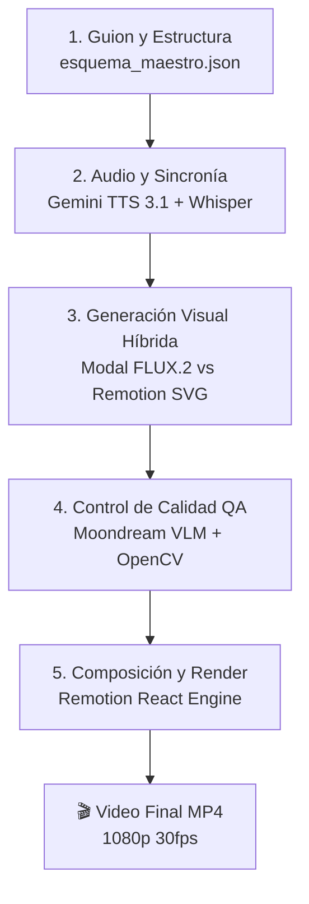
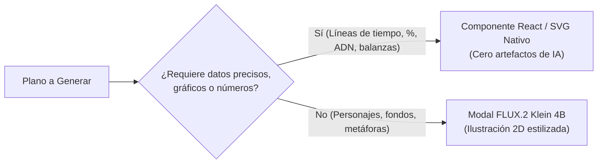

# 📚 Documentación Técnica del Sistema de Animaciones
## Pipeline Automatizado de Animación y Divulgación Científica (*Ink Explainer*)

---

## 1. Visión General del Proyecto

Este sistema es un **pipeline automatizado de producción audiovisual end-to-end** diseñado para crear videos de divulgación científica en formato documental animado de alta retención (inspirado en canales como *Kurzgesagt, Curiosamente y TED-Ed*).

### 🎯 Parámetros Clave de Producción
- **Duración estándar:** 5:00 minutos reales (300 segundos = 9,000 frames a 30 fps).
- **Resolución:** 1920 × 1080 (Full HD, 16:9).
- **Tasa de refresco:** 30 fps estables.
- **Ritmo de edición:** 2.5 a 5.0 segundos por plano (alta cadencia visual, sin planos estáticos).
- **Personaje recurrente:** **Niko**, un niño curioso con cabello turquesa desaliñado, tirita en la mejilla, camiseta a rayas amarillas y chaleco verde de explorador (o pijama en escenas de dormitorio).

---

## 2. Arquitectura del Sistema (5 Capas)

El pipeline opera a través de cinco capas interconectadas de manera modular:



---

### Capa 1: Guion y Estructura Cinematográfica (`esquema_maestro.json`)
El archivo JSON maestro es la **única fuente de la verdad** del episodio. Controla:
- **Metadatos:** Título, duración objetivo, volumen de música, estilo visual.
- **Actos:** Estructura en 3 a 5 actos dramáticos (ej. *El Misterio*, *La Fisiología*, *La Razón Evolutiva*).
- **Escenas y Planos:** Cada escena se desglosa semánticamente en micro-planos individuales con:
  - `locucion_plano`: Frase exacta del corte.
  - `duracion_frames`: Duración calculada al milisegundo por Whisper.
  - `palabras_clave_plano`: Términos que se resaltarán en color ámbar en los subtítulos.
  - `animacion`: Tipo de movimiento de cámara (`zoom_in_suave`, `paneo_suave`, `sacudida`).
  - `punch_in`: Aceleración o salto de escala dinámico en planos que superan los 5 segundos.
  - `tipo_visual`: Enrutamiento hacia `imagen_flux` o `componente_vectorial`.

---

### Capa 2: Motor de Audio y Sincronía (TTS + Whisper)

1. **Locución Sintética Oficial (Gemini TTS):**
   - **Modelo:** `gemini-3.1-flash-tts-preview`.
   - **Voz:** `Puck` (tono divulgador, dinámico y curioso).
   - **Procesamiento de Audio:**
     - Formato: WAV 48,000 Hz estéreo, 16-bit.
     - Filtro acústico: `lowpass=f=9500` con microfades de 15 ms en inicios y silencios para eliminar artefactos y siseos digitales.
2. **Forced Alignment con Whisper de OpenAI:**
   - Se ejecuta localmente `whisper` en modo `word_timestamps=True`.
   - Extrae el timestamp de inicio y fin de cada palabra al milisegundo.
   - **Garantía:** Los cortes de imagen y la aparición de subtítulos ocurren en el frame exacto en que la voz pronuncia cada palabra, eliminando desincronizaciones manuales.

---

### Capa 3: Enrutador Visual Híbrido

Para evitar el problema clásico de la IA generativa (letras deformadas, números sin sentido y relojes rotos), el sistema implementa una **bifurcación inteligente**:



1. **Vía Vectorial (React / SVG en Remotion):**
   - *Ejemplos creados:*
     - `SleepVoidTimeline`: Línea temporal de 11:30 PM a 07:00 AM con reloj analógico vectorial.
     - `BalanceScale`: Balanza biológica entre Folato y Vitamina D.
     - `DnaPieChart`: Gráfico de pastel animado del 99.9% de genoma compartido.
     - `ThermostatGauge`: Indicador solar con aguja interactiva.
2. **Vía Generativa (Modal Cloud A100 + FLUX.2 Klein 4B):**
   - Servidor GPU en la nube mediante **Modal**.
   - Modelo: `black-forest-labs/FLUX.2-klein-4B` destilado (4 pasos de inferencia en ~2 segundos por imagen).
   - Inyección de imagen de referencia de Niko para coherencia visual.
   - Guardabarros de prompt negativo: `NO text, NO letters, NO words, NO typography, clean 2D cartoon style`.

---

### Capa 4: Control de Calidad (Moondream VLM + OpenCV)

1. **Auditoría Moondream (Vision-Language Model):**
   - Inspecciona cada imagen generada contra tres preguntas estrictas:
     1. *¿Hay texto deformado o letras inventadas por la IA?*
     2. *¿La vestimenta es coherente con el entorno (ej. pijama en cama, sin zapatillas exteriores)?*
     3. *¿Hay anomalías anatómicas (manos deformes, clones accidentales, cabezas rotadas)?*
2. **Post-procesamiento Quirúrgico (OpenCV/PIL):**
   - Si una imagen tiene una pequeña imperfección (como pseudo-texto en una pantalla holográfica), scripts de inpainting con algoritmos Navier-Stokes (`cv2.inpaint`) limpian el panel para dejarlo 100% nítido.

---

### Capa 5: Motor de Composición y Render (Remotion Engine)

El video se ensambla y renderiza mediante **Remotion (React + TypeScript + Chromium)**:

- **Estructura Modular de Componentes:**
  - `Root.tsx`: Declara las composiciones (`Episodio2Preview`, `VideoEpisodio`), resolución 1080p, 30fps y duración calculada dinámicamente sumando los frames de las escenas.
  - `VideoEp2.tsx`: Orquesta las secuencias temporales (`<Sequence>`), música de fondo lo-fi con curvas de volumen interpoladas (`interpolate()`).
  - `Scene.tsx`: Renderiza la escena activa, aplica las transformaciones cinemáticas de cámara (zoom-in suave de `scale: 1.0 -> 1.07` o paneos `translateX: 0 -> -28px`).
  - `SubtitlesOverlay.tsx`: Subtítulo flotante con efecto *glassmorphism* (`backdrop-filter: blur(10px)`), tipografía moderna y resaltado selectivo de palabras clave en amarillo (#FBBF24).
  - `KineticOverlay.tsx`: Insignias científicas superiores en la esquina izquierda con animaciones de resorte (`spring()`) que resumen los conceptos clave.

---

## 3. Estructura del Repositorio

```text
Animaciones/
├── motor_animaciones/               # Núcleo modular del sistema
│   ├── pipeline_maestro.py          # Orquestador general del flujo
│   ├── pacing_semantic_splitter.py  # Segmentador de ritmo (2.5s - 5.0s)
│   ├── visual_classifier.py         # Enrutador (SVG vs FLUX.2)
│   └── oracle_moondream_gate.py     # Auditor visual con Moondream
│
├── Episodio_1/                      # Episodio 1: "Color de Piel" (Completo)
│   └── remotion_app/                # Proyecto React / Remotion compartido
│       ├── src/
│       │   ├── Root.tsx             # Registro de composiciones
│       │   ├── Scene.tsx            # Renderizador de planos y cámara
│       │   ├── Video.tsx            # Composición Episodio 1
│       │   ├── VideoEp2.tsx         # Composición Episodio 2
│       │   └── components/          # Motion graphics vectoriales en SVG
│       │       ├── SleepVoidTimeline.tsx
│       │       ├── KineticOverlay.tsx
│       │       ├── BalanceScale.tsx
│       │       └── DnaPieChart.tsx
│       └── public/assets/           # Archivos estáticos montados (audio e imágenes)
│
└── Episodio_2/                      # Episodio 2: "¿Por qué olvidamos el sueño?"
    ├── esquema_maestro_ep2.json     # JSON maestro del Episodio 2
    ├── assets/
    │   ├── audio/                   # Audios TTS de Puck procesados
    │   └── img/                     # Ilustraciones aprobadas
    ├── generar_audio_v31.py         # Generador TTS Gemini 3.1
    ├── alinear_con_whisper.py       # Alineador temporal con Whisper
    ├── corregir_ep2_p3.py           # Script generador en Modal GPU
    └── ep2_preview_1min.mp4         # Video renderizado actual (1:11 min)
```

---

## 4. Ciclo de Vida de una Escena (Paso a Paso)

```text
[Guion Texto]
     │
     ▼
1. Generar Audio TTS (Gemini 3.1 Puck)
     │
     ▼
2. Forzar Alineación Temporal (Whisper) -> Obtiene duración exacta en frames
     │
     ▼
3. Dividir en Planos (2.5s a 5.0s por plano con palabras clave)
     │
     ▼
4. Enrutar Visualmente:
     ├─► Si es abstracto/gráfico: Diseñar componente SVG en Remotion
     └─► Si es escena/personaje: Generar imagen en Modal FLUX.2
     │
     ▼
5. QA Moondream (Verificar anatomía, ausencia de texto y vestimenta)
     │
     ▼
6. Actualizar esquema_maestro_ep2.json y copiar assets a public/
     │
     ▼
7. Renderizar en Remotion: `npx remotion render Episodio2Preview`
```

---

## 5. Protocolo Anti-Errores Aprendido e Implementado

1. **Voz Consistente:** Usar exclusivamente `gemini-3.1-flash-tts-preview` con voz `Puck` y filtro paso bajo a 9500 Hz. Nunca usar modelos preview lentos o susurrados.
2. **Sincronización Absoluta:** Las duraciones de los planos nunca se adivinan a mano; provienen de los `word_timestamps` de Whisper.
3. **Cero Texto Deforme de IA:** Ningún texto informativo, reloj numérico o gráfica de datos se delega a FLUX; se programan como componentes vectoriales nativos en React.
4. **Consistencia de Personaje (Niko):** En interiores o cama, pijama a rayas sin calzado. En exteriores, camiseta a rayas con chaleco verde y zapatillas. Solo 1 figura de Niko por plano (evitar clones mediante directivas `solo single character, no other people`).
